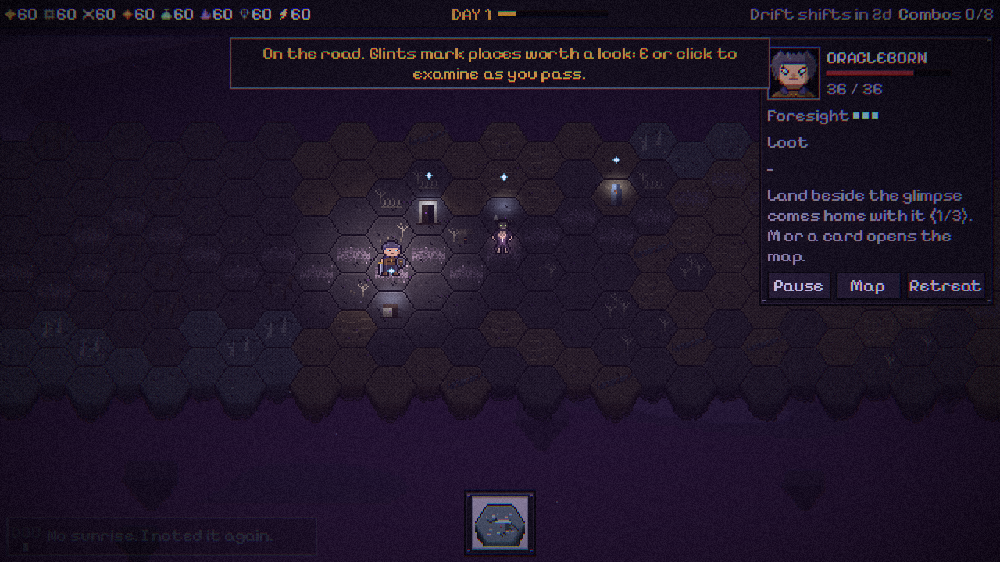
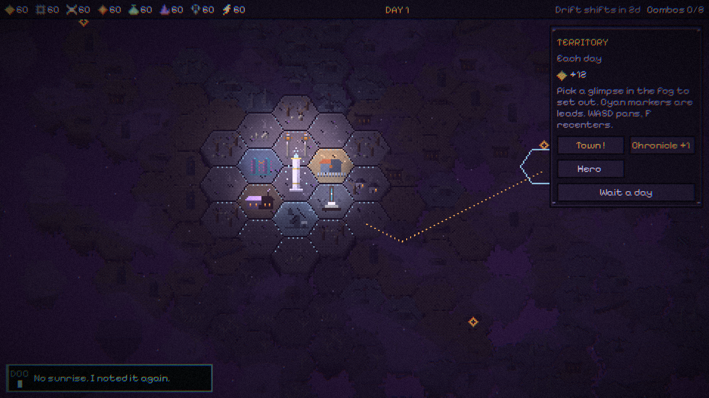
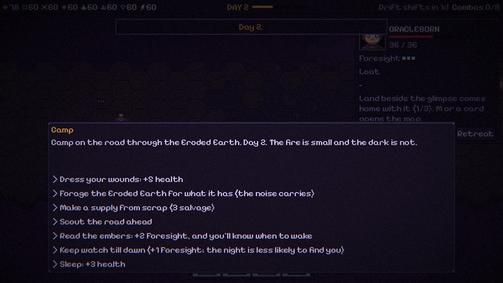

# Maelstrom — Act I

A playable Act I: three heroes, three regions, one broken world. The core loop (**glimpse → expedition → shape land → bring a fragment home**) runs under three chapters of story that end when the regions connect and the heroes meet.

- **Chapter 1, The Pillar Wakes:** the Oracleborn, his town, leads, reading the past, and the throne hall.
- **Chapter 2, The Uncoded Engineer:** the attack on the Augmented Player, the transfusion and burial, anchors that need Power, the Documenter, levels and skills, and the Book of Laws.
- **Chapter 3, Pallas:** the station falls, Alysia holds the airlock, tethers that cost Parts, the crew, three guns and ammo, survivors and settlements.
- **Act I ends** when all three regions are connected: the meeting scenes play, the second ring slot opens for everyone, and the world keeps going.

| The Way | The town | Camp |
| --- | --- | --- |
|  |  |  |

Built for **Godot 4.4 or newer** (GDScript, Compatibility renderer). The look follows **style anchor v0.2** (on the map style canvas).

## Running it

1. Open Godot, choose **Import**, and select this folder's `project.godot`.
2. Press **F5** (Run Project).

The game saves itself at the end of each day and whenever you close a screen, and picks up where you left off. **Start over** is at the bottom of the Hero screen's Gear tab.

## How to play

**Territory**
- Amber markers are **glimpses**: fragments you can make out through the fog. Hover one to see its route, click to set out. Cyan markers are **leads**: fragments someone asked you to bring in. They stay put through shifts.
- **Wait a day** to let the Drift shift first. Every 3 days far-off land re-rolls and new glimpses appear. Nights are not always quiet: things come to the edge of the lamplight.
- Fused fragments **settle** for 2 days (dashed outline). Click one to release it.
- **WASD** or the arrow keys pan the map; **F** recenters on the active hero; **Tab** switches heroes.

**Expeditions: plan, then the Way**
- **Plan.** Clicking a glimpse draws the route on the world map. Pick a tile from the tray (click or **1–6**) and click a fog hex **next to the route** to shape it, then **Set out** (Space). Shaped land pays out as you pass it, combinations between neighbors pay more, and more shaped land means more encounters.
- **The Way.** Setting out opens the road itself: every world tile on the route becomes a stretch of top-down ground in that world, its neighbors bleeding in at the edges (where the world has void beside the route, the road's edge breaks off into it). The hero walks the worn path by lantern light. **Space** pauses.
- **Notables.** Glints mark places worth a look: a wreck, a door, a standing stone, a well, a machine still running. When the hero reaches one, they wait a moment: **E** or click to examine, Space to walk on. Some are full events with choices; most are finds, each with its own short scene and a small reward. About thirty finds across the six worlds, never the same one twice until a world's are used up. **World tiles remember their notables**: the same ground holds the same places next time, and examined ones stay examined.
- **What waits on the road** is visible ahead: enemies stand on the path with a red glint, and anything dangerous to the hero as they are right now carries a sign (**!** dangerous, **!!** deadly; hover it for details). The rating weighs the hero's current health, so a wounded hero sees more signs. When you're about three steps away, you choose how to meet it: **head on**; **slip past in the dark** (about even odds, better if you scouted or have Foresight; if it sees you, it strikes first); a **hero edge** (the Oracleborn foresees its first move for 1 Foresight, the Engineer sets a turret in its path for 1 Part, Alysia takes the first shot for 1 charge and anything weak doesn't get up); or **turn back**.
- **Bandage** (B, or the button) any time on the road: a supply for +6 health. Land shaped beside a stretch sometimes adds a roadside notable from its own world.
- **Planning the route.** In the plan phase, click tiles to route through them (in the order clicked, then on to the glimpse); right-click clears. A route may run up to 4 tiles longer than the direct way. Tiles whose notables you know show a mark on the world map (a glint while something there is unexamined, a dim dot once it's all done); hover for what's there. Tiles you know nothing about show nothing.
- **Days on the road.** Every three stretches the hero makes camp and a day passes, at home too (production, upkeep, settling, perhaps a Drift shift; the road and destination are spared while you're on them). At camp you have **two things to do before you sleep** (three if a working mess hall stands in land joined to the hero): rest properly (a supply, +12 health), dress your wounds (+5), forage the local ground (resources, but the noise makes the night likelier to find you), make a supply from 3 salvage, scout the road ahead (see what waits on the next two stretches; slipping past gets easier), or the hero's own: the Oracleborn reads the embers (+2 Foresight, and the night is less likely to find you), the Engineer lets the swarm mend him (a reagent, +10 health), Alysia cleans and loads (her next fight opens with a shot already in). Then keep watch (the night is half as likely; +1 Foresight, charge or experience) or sleep (+3). Then the night: something may come to the edge of the firelight, from eight road-night events. A long trip is three or four days.
- **Ruin stories.** A few places change between visits: a family car in the Eroded Earth, a chapel whose bell hangs under the land, a terminal on a dead plaza still waiting for player two. Each has three stages, one per visit; after each, the place goes quiet for a couple of days, then something has changed there (the map tooltip says so). The last stage gives something to keep.
- **Lookouts.** Some finds are high places (a stair to nowhere, a mast, a camera gantry). Examining one marks every place worth a look within three tiles on the world map.
- **Map** (M, or pick a card) looks back at the world map mid-trip to shape land ahead; returning to the road rebuilds the stretches you haven't reached yet.
- Land shaped **next to the glimpse** comes home with it, up to the pack limit. Fused land pulls toward where it was found, so your territory grows outward.
- **Events** happen on the road: something on the tile asks a question and you choose. Choices cost or pay in resources, health, Foresight or supplies, and some leave **Omens** in the Chronicle that the game returns to later.
- **Lures:** certain shaped land draws certain things. Graves bring gravewalkers, camps bring raiders, server rooms bring drones, thorns bring the coven. You choose your enemies by what you build.
- **Retreat** keeps your loot but leaves the fragment. Losing a fight keeps half the loot, loses the glimpse and injures the hero (60% health next trip; **Rest** in town for 6 Food).

**Three ways to hold land**
- **The Oracleborn's pillar** holds land for free. Click a settled tile of another world in his land to **read its past** (takes a day; each world reads in 3 stages, needing 1, 2 and 4 stable tiles). Readings grant **visions**: his growth.
- **The Engineer's anchors** draw **1 Power per anchored tile per day**; the mast gives 2, Leaderboard land and the Signal relay combo give more. Run dry and the newest anchor fails and its land drifts loose. He has **levels, skill points** (Constructs, Swarm, Fugue) and the **Book of Laws**: anchor enough of a world's land and the Documenter writes its law, which pays that world's land more.
- **Alysia's tethers** cost **1 Part per tile** brought home. Pallas's dock makes 1 Part a day; Machine land (Eroded Earth, Leaderboard) yields more. Her **guns improve with use**, **ammo** suits enemy tags, and the **energy pistol** fires when its charge is full. **Survivors** found in the fog join Pallas: 8 people make an outpost (stores open), 14 a town (gun work).

**People and screens**
- **Town (T):** the active region's people. **!** means someone has news. Benches: Ysolde's recipes (town), the Engineer's blueprints (camp), Pallas's stores.
- **Hero (H):** Gear, Growth (visions / skills and laws / guns and the settlement) and **Behaviors**, the toggles that decide what the hero does in auto-combat.
- **Heroes talk.** Once two heroes' lands are joined, they talk at home every few days: six conversations, two per pair, each a disagreement about the Watcher from where they stand. They go in the Chronicle's Story tab.
- **The map speaks.** The first time each kind of land is shaped, and the first time two worlds touch, a line about what it is or what happens where they meet.
- **Coming home**, the home light swells to meet the hero, warmer after a good trip.
- **Talk of the town.** When someone has no story news, they still have something to say. After you examine certain things on the road, the person who'd have a view on it does (a * by their name: "Hear their news"). Otherwise, about half the time, they pass on a rumour of a place out in the fog, in their own way of telling it, and that place is marked on the world map, ready to route through.
- **Build** (in Town): **structures stand on tiles.** Pick one, then click a settled tile of your land; the tile stops yielding and the structure goes up in the material of the ground beneath it. The ground also decides what it does: a shrine on Kingdom land gives Foresight, on Hollowing land it brings the past closer, on Coven land it sweats reagents. Hover a tile in build mode to see what a structure would do there. Lamps want the edge of the land, the infirmary and mess hall want a house beside them, capacitors must touch the mast or Leaderboard land. A shrine beside a grave is asking for something.
- **The capital.** The Oracleborn's pillar town is where the heroes gather. Each hero builds their own structures on their own land (the Oracleborn: lamps, infirmary, shrine; the Engineer: capacitors, forge; Alysia: winch, mess hall), and once a hero's land joins the town's, their structures can be built anywhere on the joined land. Pallas grows by people and becomes the second core later.
- **Upkeep and damage.** Lamps burn a Sunstone every other day (every fourth on Frozen Sun ground) and go dark without it. When the Drift shifts, structures on the edge of the land may crack; a damaged structure does nothing until repaired with 3 of its ground's material (click it). Older saves' upgrades become structures on the nearest fitting tile.
- **Sound.** Quiet beds under everything (town, road, camp, plus a faint texture per hero), and over them music that takes turns, each piece once, then a breath of silence. In town your hero's theme alternates with the town's; on the road, the road's with your hero's; at camp, the camp's. **Town:** a half-remembered waltz on a music box. **Road:** footsteps, a low plucked ostinato in a darker mode, a searching horn. **Camp:** guitar in 6/8 and a hummed tune. **Oracleborn:** a broken royal processional on glass and choir, one forbidden note pulling it off course. **Engineer:** a game's level-start jingle played slow on a worn chip voice over a machine arpeggio; the second time through it glitches and sticks. **Alysia:** a lonely Western, twangy guitar on a loping shuffle and a whistled line that leaps and glides. Everything is in D, so whatever overlaps sits together. Fights duck it; **N** mutes. Beds: `tools/make_ambience.py`; themes: `tools/compose_themes.py` (numpy, scipy, ffmpeg).
- **Screen.** The game renders at 640×360 and scales by whole numbers (3× at 1080p). Text is Pixelify Sans at 11 px, the size where its pixel grid lines up; smaller sizes turn to mush.
- **The world** is 64×38 cells; the three homes sit in its middle third with deep fog on every side. The town starts two rings wide, so there is room to build. One glimpse always leans toward each other home.
- **Light.** Standing structures cast their own light: lamps amber and far, shrines pale cyan, forges ember, capacitors neon. Dark or damaged ones cast nothing. The map draws up to 24 of these alongside the three home lights.
- **The Documenter** is not a person. It speaks through the teal panel in the bottom-left when it chooses, in the present tense when the Engineer is active and in the past tense for anyone else. ~120 lines across sixteen triggers, in four tones: mechanical in chapter 1, noticing in chapter 2, opinionated in chapter 3, and after Act I something that is not an observer. What it has said is kept in the Chronicle's Record tab. Its story beats arrive on their own once the Engineer is in play.
- **Chronicle (C):** people, places, world readings, laws, story, omens, visions and combinations.

**Auto-combat** runs on its own, like Loop Hero. One or two enemies; the deeper into the fog, the worse. Two things belong to the Maelstrom itself rather than to any world: the **unmoored** and the **driftwatcher**. Armor cuts damage but never below half, so weak hits still chip. The Oracleborn spends Foresight to dodge heavy hits, the Engineer's constructs fight beside him (and his fugue may improvise), Alysia switches guns to suit the enemy.

**Tactical fights** (story battles) give direct control: move, then act; no moving after acting. Red hexes are where blows will land; step off them. The Oracleborn sees only blows aimed at him, Bashes enemies to **Read** them, and Cancels or Counters with Foresight. The Engineer deploys turrets and patches himself. Alysia shoots at range (Python 3, Glock 2, energy pistol 4) and Quick-draws.

### Combinations

| Combination | When | Effect |
| --- | --- | --- |
| Resonance | Same-world neighbors (not home land) | +1 yield each, up to +2 |
| Thaw basin | Sand (Eroded Earth) beside Ice (Frozen Sun) | +2 Food per pair |
| Rot garden | Decay (Hollowing) beside Fertile (Kingdom) | +1 Reagents per neighbor |
| Clash | Ice beside Decay | −1 Sunstone, +1 Clash shard |
| Echo resonance | Coven Wars beside Eroded Earth | +1 Salvage, +1 Reagents |
| Signal relay | Signal (Leaderboard) beside Machine | +1 Power |
| Steam vent | Fire (Coven) beside Ice | +1 Power per pair |
| Glitch garden | Neon (Leaderboard) beside Fertile | +1 Parts, +1 Food |

## Using your own pixel art

Godot draws the hex itself (shape, outline, rock underside, light, the unstable look, erosion, fog) and the screen finish. Your art covers what goes **on** the hex, plus the characters:

- `art/ground/<world>.png`: a ground texture, 32×32 or larger. Worlds: `kingdom`, `eroded`, `hollow`, `frozen`, `leader`, `coven`.
- `art/features/<feature>.png`: a transparent sprite anchored at its bottom center. Feature names are the keys of `LAYOUTS` in `scripts/worlds.gd` (`tree`, `house`, `pillar`, `mast`, `pallas`, `cauldron`, …).
- `art/notables/<kind>_<world>.png`: notable art per kind (wreck, remains, door, machine, stone, cache, light, tree, well) per world.
- `art/structures/<structure>_<world>.png`: one sheet per structure per ground world (`lamps_kingdom.png`, `forge_eroded.png`, …), anchored at its bottom center. Until then Godot draws each silhouette in the ground's material.
- `art/characters/<name>.png`: hero sprites and portraits (`hero_oracleborn_sprite`, `hero_engineer_portrait`, `hero_alysia_sprite`, …), enemies (`enemy_drifter_raider`, `enemy_sentry`, `enemy_hound`, `enemy_wisp`, `enemy_drone`, `enemy_armored_man`, `enemy_mastiff`, …) and `npc_player`. See `CharArt.lookup` for the full list.

Draw tiles in their world's own dark palette from the style anchor and the PixelLab prompt sheet; the unstable look, the light and the haze are made in Godot.

## Where things are

| File | What it does |
| --- | --- |
| `scripts/main.gd` | Game flow: territory, expeditions, encounters, returning, days, power and parts, chapters, saving |
| `scripts/story.gd` | Act I's people, talks, leads, readings, visions, laws, Chronicle text and scenes (autoload `Story`) |
| `scripts/way.gd` | The Way: builds the road from the route's world tiles, draws it, places notables and encounters, the lantern light (class `Way`) |
| `scripts/town_talk.gd` | Talk of the town: rumours in each person's voice, reactions to what heroes found (autoload `TownTalk`) |
| `scripts/ambience.gd` | Ambience: place and hero layers, crossfades, ducking, mute (autoload `Ambience`) |
| `audio/*.ogg` | The ambient loops |
| `scripts/notables.gd` | Notables: how events look from the road, ~30 per-world finds, rolling a tile's notables (autoload `Notables`) |
| `scripts/events.gd` | Expedition events and choices, night events, drone sightings, lures, omen entries (autoload `Events`) |
| `scripts/documenter.gd` | The Documenter: line pools in two tenses, cadence, the Record, its auto-firing story beats (autoload `Documenter`) |
| `scripts/items.gd` | Gear: slots, ~75 items, drops per world, recipes, blueprints, Pallas's stores, structures (autoload `Items`) |
| `scripts/bestiary.gd` | Enemies with tags, stats and specials, per world (autoload `Bestiary`) |
| `scripts/hero_state.gd` | The three heroes: equipment, visions, levels and skills, mastery, behaviors |
| `scripts/map.gd` | Cells, three regions, land ownership and connection, glimpses, leads, routes, fusing, fog |
| `scripts/battle.gd` | Auto-combat: groups, specials, constructs and fugue, guns and ammo |
| `scripts/tactics.gd` | Tactical fights: three scenarios, per-hero toolkits |
| `scripts/screens.gd` | Town, Chronicle and Hero screens, dialog and scenes |
| `scripts/hud.gd` | Interface: top bar, side panel with hero switch, card tray, tooltip, banner |
| `scripts/rules.gd` | Combination rules and the Book of Laws bonus |
| `scripts/worlds.gd` | World data: palettes, tags, yields, layouts |
| `scripts/tile_factory.gd` | Tile textures, the sky, your PNGs, placeholder pixel art, sprites and icons |
| `scripts/char_art.gd` | Placeholder character pixel art |
| `scripts/post_fx.gd`, `shaders/` | Light pools, the unstable look, the purple haze, grain and vignette |
| `tools/screenshot.gd` | Dev helper: `godot --path . -- --shot=out` saves screenshots of a scripted session |
| `tools/chapter_test.gd` | Dev helper: `godot --path . -- --test` plays through all of Act I and prints checks |
| `tools/sim.gd` | Dev helper: `godot --path . -- --sim` runs 42 expeditions and prints fight, event and injury statistics |
| `tools/fight_sim.gd` | Dev helper: `godot --path . -- --fights` plays each tactical scenario 8 times with a rote fighter |

All three run headless-ish; on a machine without a display, start `Xvfb :99 -screen 0 1440x810x24 &` and set `DISPLAY=:99`.

## Tuning

Writing: all dialogue, Chronicle text and scenes are in `scripts/story.gd`; road and night events in `scripts/events.gd`; items and upgrades in `scripts/items.gd`; enemies in `scripts/bestiary.gd`. Edit them freely.

Constants at the top of `scripts/main.gd`: step speed, hand size, draw chance, encounter, lure and pair rates, event and night-event chances, drop and survivor chances, fragment size, days between shifts, the mast's Power.

Balance notes from the last pass are in `PLAYTEST.md`. Hero base stats, skills and mastery are in `scripts/hero_state.gd`. The look's numbers are uniforms at the top of the shaders.

## Credits

Font: Pixelify Sans, © The Pixelify Sans Project Authors, SIL Open Font License 1.1 (see `fonts/OFL.txt`).
